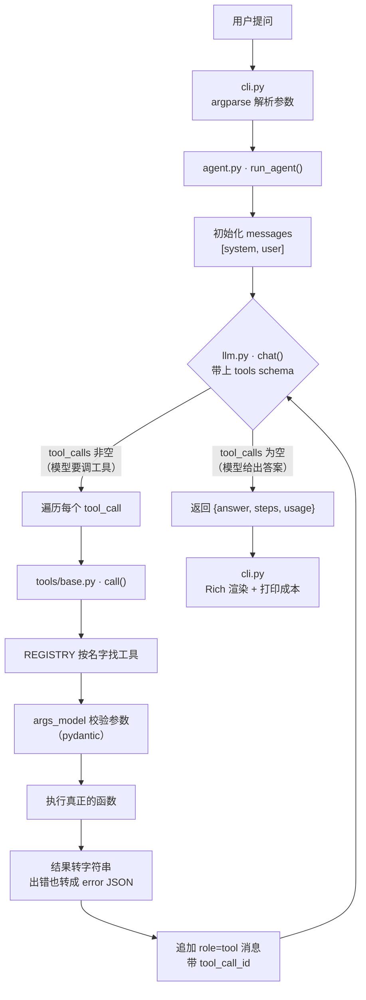
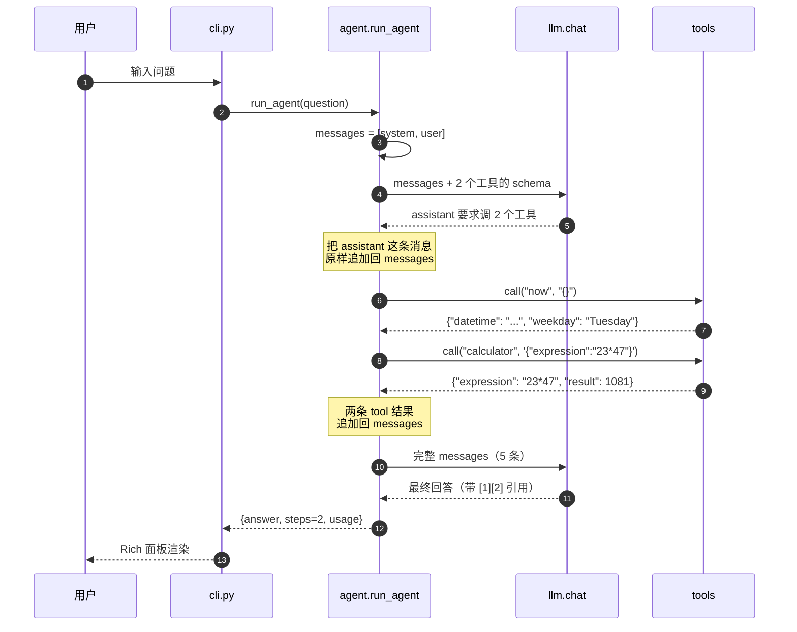

# 项目总览：这个 Agent 是怎么工作的

> 读完这一页，你应该能对着白板讲 10 分钟"我的 agent 是怎么跑起来的"。

## 一句话概括

**输入一个问题 → 模型自己决定调哪些工具 → 拿到结果再决定下一步 → 带引用地回答。**
整个"决定"的过程里，没有一行 if-else 是写死的 —— 决策权在模型，代码只负责执行和传递。

---

## 一、全景架构



**三条线要分清楚：**

| 线 | 归谁管 | 特点 |
|---|---|---|
| **决策线** | 模型 | 调不调工具、调哪个、调几次，全由模型决定 |
| **执行线** | 你的代码 | 只做"校验参数 → 执行 → 序列化结果"，不做判断 |
| **记忆线** | `messages` 数组 | 唯一的上下文载体，每轮往里追加，不改写 |

---

## 二、一次真实请求的时序

以 `"现在几点，顺便算一下 23*47"` 为例：



**注意 `autonumber` 的第 4 步和第 9 步：只调用了两次模型。**
同一个 step 里并发调了两个工具 —— 这是"并行工具调用"，能显著降延迟，后面做检索时会常用。

---

## 三、`messages` 数组的演化（本项目最核心的概念）

### 第 1 轮请求发出去的内容

```jsonc
[
  { "role": "system", "content": "你是一个严谨的研究助手。规则：1. 涉及事实..." },
  { "role": "user",   "content": "现在几点，顺便算一下 23*47" }
]
```

### 模型返回

```jsonc
{
  "role": "assistant",
  "content": null,          // 注意：要调工具时 content 是空的
  "tool_calls": [
    { "id": "call_abc", "type": "function",
      "function": { "name": "now", "arguments": "{}" } },
    { "id": "call_def", "type": "function",
      "function": { "name": "calculator", "arguments": "{\"expression\":\"23*47\"}" } }
  ]
}
```

### 第 2 轮请求发出去的内容（5 条）

```jsonc
[
  { "role": "system",    "content": "..." },
  { "role": "user",      "content": "现在几点，顺便算一下 23*47" },
  { "role": "assistant", "content": "", "tool_calls": [ ... ] },      // ← 原样回填
  { "role": "tool",      "tool_call_id": "call_abc", "content": "{\"datetime\":\"2026-11-25 23:40:26\",...}" },
  { "role": "tool",      "tool_call_id": "call_def", "content": "{\"result\": 1081}" }
]
```

### 三个必须理解的细节

1. **`assistant` 那条不能省。** 少了它，模型看不到"自己刚才发起了调用"，会重复调同一个工具，直到 `max_steps` 耗尽。
2. **`tool_call_id` 是配对用的。** 模型可能一次发多个调用，靠 id 把结果和请求对应回 去，顺序不重要。
3. **`content` 永远是字符串。** 所以工具返回 dict 也要 `json.dumps` —— 协议只认字符串。

---

## 四、模块职责

| 文件 | 行数 | 职责 | 换掉会影响什么 |
|---|---|---|---|
| `config.py` | 40 | pydantic Settings，从 `.env` 读配置 | 全局 |
| `llm.py` | 95 | DeepSeek 客户端、重试、token 记账 | 换模型只改这里 |
| `tools/base.py` | 84 | 装饰器注册、schema 生成、执行与兜底 | 全部工具 |
| `tools/builtin.py` | 85 | `now` / `calculator` | 不影响核心 |
| `agent.py` | 86 | ReAct 循环 | 项目的心脏 |
| `cli.py` | 70 | 参数解析 + 渲染 | 只影响交互方式 |

---

## 五、四个关键设计决策（面试就考这些）

### 决策 1：不用 LangChain

**做法**：ReAct 循环、工具注册、schema 生成全部手写。

**理由**：
- 学习目标就是"理解 agent"，用框架等于跳过要学的东西
- 86 行代码 vs 一层层抽象，出问题时你能直接定位到第 50 行
- 面试官问"agent 循环怎么写"，能背出 LangChain 的 API 和能写出循环，是两个层级

**代价**：没有现成的 checkpoint、流式、多 agent 编排。W7 之后如果要，再用 LangGraph 重写一遍做对比 —— 那个对比本身就是很好的面试素材。

### 决策 2：用 pydantic 模型当 schema 的唯一来源

**做法**：`@tool(CalcArgs)` 里传的是参数模型，`Tool.schema()` 调 `model_json_schema()` 自动生成。

**理由**：手写 JSON Schema 最容易犯的错是**和函数签名不一致** —— 改了参数忘了改 schema，模型就会传错参数，而且报错信息极其难查。用 pydantic 之后，改参数只改一个地方。

**代价**：schema 里会多出 `title` 等字段，浪费一点 token。

### 决策 3：工具执行失败不抛异常，而是变成一条 observation

```python
try:
    result = self.func(**parsed.model_dump())
except Exception as e:
    return json.dumps({"error": f"{type(e).__name__}: {e}"})
```

**理由**：agent 的价值在于**自我纠错**。工具返回 `{"error": "参数不合法"}`，模型能看到、能改参数重试；如果直接抛异常，整个请求就崩了，用户只看到 500。

这是"把错误当成数据"的思路，和传统后端"异常向上抛"完全相反。**面试里问"你的 agent 怎么处理工具失败"，这就是答案。**

### 决策 4：`llm.chat()` 返回原始 completion 对象，不返回字符串

**理由**：上层需要拿到 `tool_calls` 才能决定下一步。如果这层就 `.choices[0].message.content` 切片成字符串，tool_calls 就丢了。

**原则**：**底层不做业务判断**。`llm.py` 只负责"发一次请求、记一次账"，怎么用返回结果是 agent 的事。

### 补充：系统提示在干什么

```python
SYSTEM_PROMPT = """你是一个严谨的研究助手。规则：
1. 涉及事实、数字、时间的问题，必须先调用工具，不要凭记忆回答。
2. 回答中的每个事实都要标注来源编号，例如 [1][2]。
3. 检索不到就明确说"资料中没有找到"，绝不编造。
4. 用中文回答，简洁，不要复述题目。"""
```

这四条不是"礼貌用语"，每一条都对应一个可观测的失败模式：

| 规则 | 防的是 |
|---|---|
| 1 | 模型凭训练记忆瞎报时间和数字（幻觉的最常见形态） |
| 2 | 答案无出处，无法验证（W5 要把它变成可点击的引用） |
| 3 | 检索不到时编造（比说"不知道"糟糕得多） |
| 4 | 输出啰嗦、复述题目，浪费 token |

---

## 六、为什么这么分层（可替换性）

```
        ┌─────────────┐
        │   cli.py    │  ← 换界面：加个 api.py 就行，agent 不动
        └──────┬──────┘
               │
        ┌──────▼──────┐
        │  agent.py   │  ← 换范式：ReAct → Plan-and-Solve，只改这一个文件
        └──────┬──────┘
               │
   ┌───────────┴───────────┐
   │                       │
┌──▼──────┐          ┌─────▼──────┐
│ llm.py  │          │  tools/    │
│ 换模型   │          │  加工具     │
└─────────┘          └─────┬──────┘
                           │
                     ┌─────▼──────┐
                     │  rag/      │  ← W4 加，tools 调用它，agent 不知道
                     └────────────┘
```

**四个"只改一处"：**

| 想做的事 | 只改哪里 |
|---|---|
| 换成 Qwen / GPT | `llm.py` 的 `base_url` 和 `model` |
| 加一个工具 | `tools/` 里加个函数，`__init__.py` import 一下 |
| 加 RAG 检索 | 新增 `tools/retrieve.py`，`agent.py` 完全不用动 |
| 换成 Plan-and-Solve | 只改 `agent.py` 的循环结构 |

---

## 七、现在 vs 最终版

| 能力 | 现在（W2） | W4–W6 之后 |
|---|---|---|
| 工具 | `now` / `calculator` | + `retrieve` / `fetch_url` / 领域工具 |
| 检索 | 无 | bge-m3 + Chroma + reranker |
| 引用 | prompt 要求要有，但无来源 | 编号可回溯到原文片段 |
| 评测 | 5 条种子 | 20 条 + 可追溯率/覆盖率/延迟/成本 |
| 界面 | CLI | CLI + FastAPI/SSE 流式 |
| 部署 | 本地 `uv run` | Docker Compose |

---

## 八、30 秒面试版

> 我做了一个不依赖框架的 ReAct Agent。核心是一个 86 行的循环：把 `messages` 和工具 schema 发给模型，模型要么直接回答、要么返回 `tool_calls`；我执行工具、把结果作为 `role=tool` 消息追加回去，再发给模型，直到它给出答案。
>
> 工具有两种设计我认为比较关键：一是用 pydantic 模型自动生成 function calling 的 schema，保证参数定义和函数签名永远一致；二是工具执行失败不抛异常，而是返回一条 `error` observation，让模型自己纠错重试 —— 这比 500 崩溃更符合 agent 的工作方式。
>
> 检索层是后加的，agent 完全不知道数据从哪来，只看到一个新工具。
